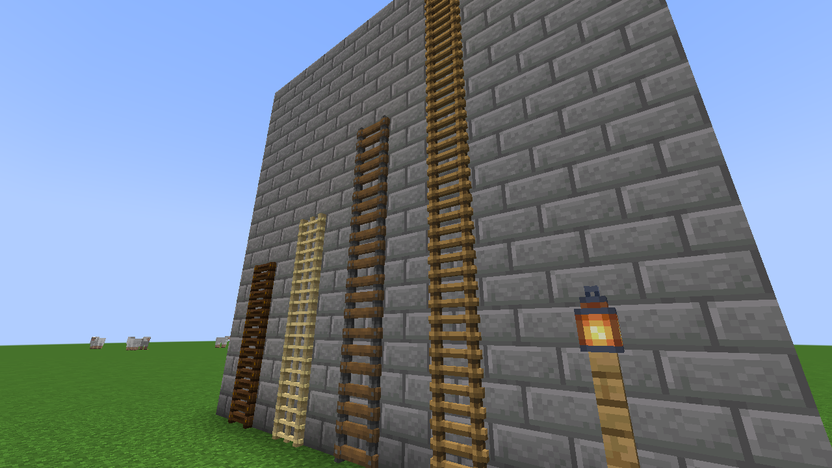

# The Local Ladders

NeoForge 1.21.1 mod (21.1.x) for The Local's server: ladders look like real 3D ladders, and you can extend a ladder
column by right-clicking it with another ladder. Our own clean-room code, MIT licensed. Adds no blocks or items:
take it out and every ladder in the world is still a normal ladder.



## 3D ladders (client)

- Every ladder drawn as one flat picture (vanilla's and other mods' `LadderBlock`s, e.g. Quark's spruce/birch/...
  ladders) gets a 3D model: two rails standing out from the wall and rungs set between them that poke out past the
  rails a little.
- The model is cut from **that ladder's own texture**: the rails are the fully drawn columns of the picture, the rungs
  the rows drawn all the way across. So every wood keeps its own colours, and a resource pack's ladder texture is
  still used. Anything else drawn in the picture (vines, broken bits) is kept with a pixel of depth.
- A ladder texture that isn't rails-and-rungs (Quark's twisty crimson and warped ladders) gets depth pixel by pixel,
  like a held item.
- Ladders whose model is already 3D (Create's metal ladders) are left alone.
- Hitbox, climbing, the item icon and everything else are vanilla's. The log says how many ladders were changed:
  `[localladders] 3D ladder models: N block states swapped ...`.

## Extending a column (server + client)

Right-click a ladder (its front, top or bottom) with a ladder in your hand, sneaking or not: one ladder is added at
the end of that column, facing the same way. Which end:

1. You clicked the top or bottom of the ladder: that end.
2. You look up or down more than 20°: up or down.
3. You look roughly straight at it: the upper half of the ladder you clicked = up, the lower half = down.

It goes past every ladder already in the column to the first free spot (air or water; water makes it waterlogged).
The new ladder is placed exactly like a normal right-click on that spot: it needs a solid wall behind it (or, with
Quark's Enhanced Ladders "Allow Freestanding" on, as on The Local, it may hang under the ladder above it, so you can
extend down a shaft with no wall), uses one ladder outside creative, fires NeoForge's block place event (claim mods can
stop it), and respects spawn protection and adventure mode. The spot must be within your normal reach + 1.5 blocks.
If it can't be placed, nothing happens and nothing is used. Clicking the side of a ladder still works like vanilla
(another ladder beside it on the wall). Create's metal ladders keep Create's own behaviour
(`data/localladders/tags/block/not_extendable.json`).

Quark's Enhanced Ladders also adds a ladder at the bottom when you right-click one; this mod handles the click first,
so you get exactly one ladder, at the end you chose.

## Building and testing

```
tools/gradle-docker.sh build                # jar in build/libs (memory-capped container, host ~/.gradle + JDK 21)
tools/gradle-docker.sh runGameTestServer    # 17 GameTests: up, down, level look, top face, sneaking, end of column,
                                            # no wall, hanging (Quark only), creative, adventure, claim cancel,
                                            # too far, blocked, facing next to another wall, water, side face, other items
tools/fullpack-test.sh build/libs/*.jar     # the same scenarios inside The Local's full modpack (Quark etc.),
                                            # -Dlocalladders.selftest=true, throwaway docker copy only
```

`LadderScenarios` holds the scenarios (a fake player clicking through `ServerPlayerGameMode.useItemOn`, the real
server path); `SelfTest` runs them in a full server and logs `[localladders-selftest] SUMMARY n/n passed`.

The Forge 1.20.1 version is on `main`; this branch (`neoforge-1.21.1`) builds with NeoForge's ModDevGradle and official
mappings, without decompiling Minecraft (`disableRecompilation`: Vineflower needs more memory than the build container
has). `tools/fullpack-test.sh` still points at the 1.20.1 host kit.
